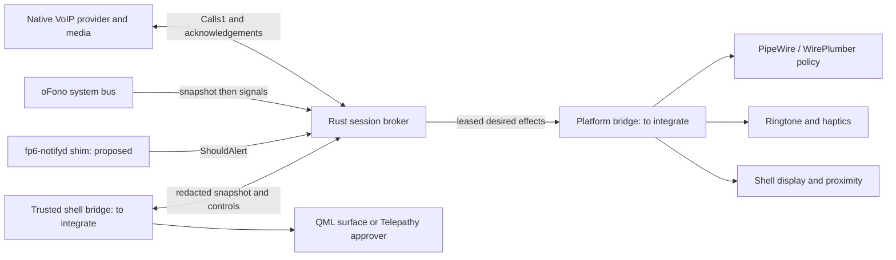

# Calls1 design and integration decision

## Scope and delivery boundary

`com.fairphone6.Calls1` is a **session-bus system component**, run by systemd **user** services. It is not a root/system-bus application API. This repository implements a Rust broker, native provider client, real oFono observer, deterministic policy, ephemeral history, synthetic integration harness, and a Qt 5.15 / UITK 1.3 incoming-call prototype.

The repository initially contained only `TASK.md`. There is no Fairphone board configuration, fp6-notifyd source, shell extension, audio policy, or history-service adapter to modify. Consequently, the DND shim and platform interfaces below are **proposed contracts**, exercised with mocks, not assertions about installed phone APIs. No complete Telepathy connection manager, actual lock-screen embedding, physical ringtone/vibration driver, PipeWire route driver, proximity sensor driver, or native history writer is shipped. Enabling the module alone does not provide cellular-equivalent phone integration. These are explicit integration gates, not silently simulated hardware success.

## Research and recommendation

Apple's provider concept separates an application's VoIP signalling from system call presentation. Providers report calls and receive system actions; action completion matters because the app can fail to answer or hold. Calls1 uses the same separation and acknowledgement principle. [Apple CXProvider](https://developer.apple.com/documentation/callkit/cxprovider)

Android Telecom distinguishes managed ConnectionService integration with the system phone UI from self-managed applications. Registration uses PhoneAccount; the framework coordinates calls and sends answer, reject, hold and disconnect requests. Calls1 similarly keeps media in the provider and centralizes arbitration. [Android ConnectionService](https://developer.android.com/reference/android/telecom/ConnectionService)

Telepathy Call1 supplies call states, Accept/Hangup, media contents, and mute interfaces. A CM must implement the surrounding connection, channel and content contracts; a bus name alone is insufficient. External media ownership must be reconciled with handler assumptions. [Telepathy Call1 specification](https://telepathy.freedesktop.org/spec/Channel_Type_Call.html)

The upstream Lomiri source was fetched read-only at commit `8b33e68db0fde2c9bd5f14ca443c94399a871a7c`. Its approver accepts audio Call1 channels, then rejects accounts whose protocol is absent from ProtocolManager. The tree includes a voice-only SIP protocol description and documentation for adding protocols. This is concrete evidence of intended non-cellular extensibility, not proof that arbitrary app-owned media works unchanged. The inspected upstream revision is not necessarily the phone's revision. [Approver](https://gitlab.com/ubports/development/core/lomiri-telephony-service/-/blob/8b33e68db0fde2c9bd5f14ca443c94399a871a7c/approver/approver.cpp), [protocol configuration](https://gitlab.com/ubports/development/core/lomiri-telephony-service/-/blob/8b33e68db0fde2c9bd5f14ca443c94399a871a7c/protocols/README.protocols), [SIP descriptor](https://gitlab.com/ubports/development/core/lomiri-telephony-service/-/blob/8b33e68db0fde2c9bd5f14ca443c94399a871a7c/protocols/sip.protocol).

| Approach | Reuse | Cost and risk | Decision |
|---|---|---|---|
| Each app implements a Telepathy CM | Existing approver, dialer and history pipeline | Large protocol surface per app; media ownership and protocol allowlist integration | Avoid for the provider API |
| One Calls1-to-Telepathy CM | Shared approver, dispatch, history and potentially shell call surface | Must implement real CM/Connection/Requests/Call1/hold/mute/content contracts and configure a protocol; test handler media assumptions | Preferred production integration, conditional on a phone proof of concept |
| Calls1 plus a shell-owned dedicated call surface | Small native API; app retains its media | Must separately integrate lock screen, history, audio, DND and sensors; can duplicate alerts | Implement broker and QML prototype now; fallback if CM validation fails |
| Normal third-party fullscreen window | Easy prototype | Cannot legitimately appear above the lock screen; lacks focus arbitration and shared history | Never use as production lock-screen integration |

**Recommendation:** retain Calls1 as the stable small provider API and implement a *single* Telepathy bridge for the target stack after validating one incoming and one outgoing app-owned-media call through Lomiri's handler. The current separate QML surface is an integration prototype and possible shell fallback. Exactly one presenter/ringer/history writer must own a call: never enable both a Telepathy approver and the separate surface for the same call.

The CM spike must prove: account registration in Mission Control, supported `.protocol` installation, incoming `NewChannels` dispatch, acceptable `HardwareStreaming`/content semantics, provider action acknowledgements, handler hangup/hold/mute, one native history record and lock-screen approval. A plausible mapping is Ringing → Call1 Initialised, pending Answer → Accepted only after provider acknowledgement, media ready → Active, Ended → Ended. Held belongs to Telepathy's hold interface rather than a new Call1 state. No descriptor claiming to implement this CM is installed by this repository.

## Architecture

The service never transports media or credentials and never dials, holds or hangs up cellular calls. It only reads oFono. Providers must maintain a persistent session-bus connection, stop media on terminal state or broker loss, and acknowledge controls only after applying them. The synthetic provider does not contain a network/media engine.

### State and concurrency

- Incoming calls start Ringing; outgoing calls start Dialing. Only outgoing Dialing may use ReportConnected. Incoming calls require shell Answer and provider Complete.
- Answer/Resume reserve focus while pending. At most one call may be Dialing/Active or acquiring focus. A second incoming call can wait, with audible/vibration alerts suppressed while another call is Active.
- Hold requires Active; Resume requires Held. Muting and route selection require Active/Held. A rejected command leaves the previous state intact. One action can be pending per call; End supersedes it.
- End is immediate for policy/effects and generates a best-effort provider End command. Remote end is idempotent. Late or mismatched serial acknowledgements fail.
- A 5-second command deadline terminates uncertain calls. Providers also read their call state; a lost acknowledgement can mean no remaining pending command. Ringing expires after 45 seconds, Dialing after 60. A 100 ms loop delivers effects; owner and DND maintenance occur approximately once per second, with bounded 300 ms DND/platform calls.
- Cellular Busy or Unknown forbids new activation. A newly busy/lost cellular observer preempts Active/Dialing calls and pending Answer/Resume with End. Ringing calls can remain silent/waiting; Held calls cannot resume until Idle. The model additionally supports Emergency, which rejects incoming and ends all calls. The observer cannot identify emergencies from the inspected standard API, so **all cellular calls get priority**. It does not infer emergency status from caller numbers.

The observer subscribes before enumerating all advertised VoiceCallManagers, then tracks CallAdded, CallRemoved and State PropertyChanged. It re-enumerates after modem topology changes and oFono owner changes, returning Unknown on errors, no voice manager, or loss of service. It deliberately does not copy numbers or contact names. oFono's documented initial snapshot followed by signals is used rather than continuous GetCalls polling. [VoiceCallManager](https://raw.githubusercontent.com/rilmodem/ofono/master/doc/voicecallmanager-api.txt), [VoiceCall states](https://raw.githubusercontent.com/rilmodem/ofono/master/doc/voicecall-api.txt).

No userspace observer can atomically arbitrate with a modem it does not own. Signal/snapshot and dispatch latency can briefly overlap media. A production Telepathy/WirePlumber integration must enforce audio focus independently; the broker's model is not a hard real-time audio lock.

### DND

The assumed shim is session name/interface `com.fairphone6.Notifications1`, path `/com/fairphone6/Notifications1`, `ShouldAlert(s category) -> (b sound, b vibration)`. The category is always `internet-call`; caller-supplied contact names, app IDs and claimed emergency/favourite flags cannot obtain an exception. This signature must be adapted to the actual fp6-notifyd introspection before phone deployment.

No reply, wrong signature, error or 300 ms timeout means both flags false. Sound and vibration are independently gated. Decisions are rechecked during ringing and cached for roughly one second; DND transitions have that bounded refresh delay plus bus/effects dispatch. A silent visual incoming-call surface still appears. If the phone's DND policy also forbids waking/showing UI, extend the contract with a separate visual permission before release. Favourite/repeat-call exceptions require a trusted contacts/policy resolution path; none is fabricated here.

### Platform and shell

`docs/DBUS_API.md` defines the leased `Apply` contract. Effects express desired ringtone, vibration, incoming surface, audio call/route/mute, and screen-off state. Only an adapter's successful Apply reply sets `platform_ready`; missing adapters remain visibly unavailable. It is not a per-device capability negotiation or proof of media flow. A production adapter must return errors when it cannot fulfill requested effects.

The bridge should run inside, or under the control of, the trusted Lomiri shell. It embeds the QML item on the shell's call/greeter layer without unlocking the device. It owns `com.fairphone6.CallsShell1`, retrieves redacted snapshots, sends controls and sensor readings, and exposes only call controls while locked. An ordinary app desktop entry cannot grant lock-screen privilege. Preview.qml has no bus integration; its local transitions are explicitly synthetic. IncomingCall.qml itself emits intents and does not assume an Answer succeeded.

The platform implementation must:

1. Replace the entire desired state idempotently; renew a 2500 ms lease and stop sound/vibration, release audio focus and restore the display on lease expiry, broker owner loss or its own restart. Never release a different call's resources.
2. Play a packaged local ringtone through a dedicated PipeWire notification stream and use the board's haptic API. Start/stop both independently from DND flags. Do not download ringtones or permit app-controlled executable/URI arguments.
3. Use WirePlumber policy for the provider's identified playback/capture nodes and communication role. Select the board's earpiece/speaker ports and Bluetooth HFP/HSP duplex profile, restoring previous routing on end. A2DP alone is insufficient for a headset microphone. Do not globally change the default sink or mute all microphones to implement one call's control. Node identities must be bound to the authenticated provider, with hot-unplug and route-error handling.
4. Feed proximity into SetProximity; blank only Active + Earpiece + Near. Hold, End, Speaker and Bluetooth release blanking. Shell disconnect clears stale near state. Physical sensor ownership and compositor display inhibitions belong to the bridge, not direct writes to a guessed sysfs node.
5. Consume completed history exactly once per broker epoch or let the Telepathy observer produce the native history record. The in-memory broker history is usable now; native Lomiri history integration is not included. Persistence should be explicit opt-in, user-private, bounded and deletable; do not write a guessed history-service database schema.

## Privacy, trust and recovery

Each provider call is owned by the D-Bus **unique sender name**, never by an asserted app ID. Peers cannot read/control another provider's calls. Shared Changed signals carry only a revision; snapshots are controller-only and always redact names. No telemetry, contact lookup, avatars, network sockets, persistent logs or call database are created. The history is RAM-only, limited to 100 records, contains no contact/name, and disappears on restart. App IDs remain unverified display metadata. Call IDs and monotonic timestamps are scoped to a broker process; consumers must reset caches on bus-owner change.

There are eight live calls globally, two per owner, 128 total retained calls, 128-byte app/name inputs and bounded command payloads. Terminal calls remain for ten seconds independent of clearing history, so providers can observe End commands. These are resource bounds, not a complete anti-spam policy or app registration portal. Apps sharing a UID can reconnect to evade per-owner limits.

The controller role checks the current owner of a well-known name. **This is a cooperative same-user trust model, not sandbox authentication:** an unrestricted same-user process can claim that name before the real shell. Production must use app confinement/a brokered portal and bus policy to reserve shell/platform/DND names and restrict privileged methods. A portal must resolve app identity and stream identity independently. Do not market this prototype as resistant to malicious unrestricted desktop apps.

Service shutdown resets effects; crash recovery depends on the platform's lease. Provider disappearance is detected within the maintenance interval. A provider ignoring End or broker disconnect can keep its own media running; production stream-level policy must revoke it. No application state is resurrected automatically on service restart.

## Phase 2: Waydroid / Android

A native bridge should be the sole Calls1 provider for a Waydroid user/container, using opaque per-call IDs and an epoch. A privileged Android-side integration observes Telecom calls and sends updates over an authenticated, narrowly scoped host/guest channel; it translates Answer/Hold/Mute/End only after Telecom confirms the operation. Reconnect must reconcile calls, reject stale commands and tear down expired leases.

A normal app cannot simply bind to and intercept every other app's ConnectionService. Evaluate the default-dialer InCallService role, Android version-specific self-managed-call visibility, OEM/system privileges and user consent. Do not assume every messenger registers with Telecom. Apps that bypass Telecom need their own integration; screen scraping is out of scope. [Android default phone application / InCallService](https://developer.android.com/develop/connectivity/telecom/dialer-app)

Keep guest media inside Android and explicitly coordinate host PipeWire transport/audio focus. Avoid duplicate Android and Lomiri ringing, history and lock-screen surfaces; select one presentation owner. Do not forward caller identity while locked, grant blanket container access to the session bus, forward emergency controls, or automatically grant Android roles. Guest death, host restart, Bluetooth, native/cellular conflicts, DND disagreement and multi-user isolation need separate acceptance tests. Phase 2 is documentation only.
