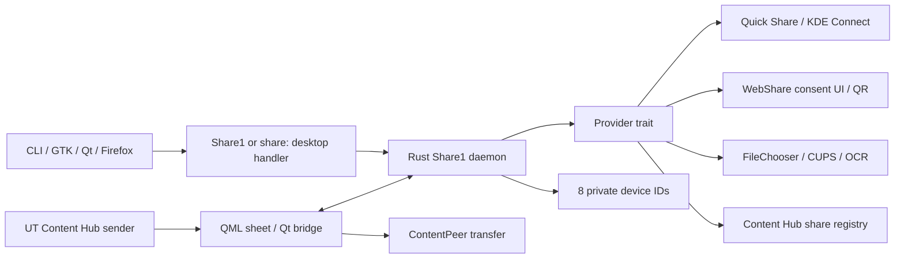

# Design and integration contracts

`fp6-share` mediates explicit local sharing in the graphical user's session.
The Rust daemon owns request validation, capability filtering, dispatch and
recent identifiers. A separate QML process owns touch presentation, clipboard
access and Content Hub's Qt transfer objects. It uses Qt 5.15 and UITK 1.3;
handwritten Rust contains no unsafe code. qmetaobject generates the necessary
Rust/Qt FFI in the UI executable; the core crate forbids unsafe code.



## Service and request lifetime

Session name/interface `com.fairphone6.Share1`, path `/com/fairphone6/Share1`:

| Method | D-Bus input | Result |
| --- | --- | --- |
| Share | `as items, s mime, s source_app` | empty; validates and shows the sheet |
| Snapshot | none | `s` JSON: revision, request, content_type, targets, recent, busy, status |
| Select | `t revision, s target_id, s option` | `s` tagged outcome JSON; option is `confirm` only for printing |
| Cancel | `t revision` | empty; clears the pending request |
| ClearHistory | none | empty |
| Attach | none | empty; records the UI's actual D-Bus sender for lifetime tracking |
| QuickJob | `s transfer_id` | `s` Quick Share transfer JSON |
| OcrJob | `s job_id` | `s` OCR job JSON |
| CancelJob | `s provider, s job_id` | empty; provider is `quick` or `ocr` |

Failures are D-Bus `org.freedesktop.DBus.Error.Failed`. Share returns after
opening the UI and initial target enumeration, not after transferring content.
Select outcomes are `{kind,value}`: `copy`, `content`, `quick`, `ocr`, `message`.
The UI interprets the first four as Qt work or jobs to poll. Message outcomes
state that an action started/queued; they do not claim end-to-end delivery.

One request is active at a time. New requests do not replace it. Revisions prevent
stale clicks; a dispatch re-enumerates its provider before proceeding. The action
mutex serializes Share/Select/Cancel; snapshots stay available while an action
runs. UI D-Bus calls run on a worker thread with a bounded command channel;
results are queued for the Qt thread. The Qt event loop performs no provider
D-Bus calls or file copies.

The UI registers its unique bus name with Attach. Child-process exit or loss of
that connection releases the request and discovery. Busy operations can finish
before cleanup; SaveFile has a five-minute dialog deadline and outer actions
have a 310-second bound. Closing the sheet does not undo an already-dispatched
transfer, a print job or an OCR job. Use its explicit Cancel control or the
provider's own UI. The daemon handles SIGINT/SIGTERM and stops owned discovery.
A daemon restart drops its in-memory request.

## Extensible providers

`Provider: Send + Sync` has an ID, async `targets(Connection, Request)` and async
`activate(Connection, Request, Target, option)` methods. Register another boxed
provider in `providers::defaults()`. The core owns stable `provider:local-id`
keys; labels are presentation only. Independent provider enumerations run
concurrently with three-second limits. A missing bus owner, incompatible payload,
failed method or invalid snapshot hides that provider. Two-second polling
recovers from late starts and owner changes; Quick Share signals trigger earlier
refresh. The bus connection also bounds individual provider method calls.

Compatibility is capability-based. For example, the supplied KDE Connect API's
`Action(id,"share",data)` parses a local file URL or HTTP(S), so it is omitted
for arbitrary text. Its devices must be online, paired and have `plugins.share`
enabled. Files are sent one at a time; a later error explains that previous items
may already have been dispatched. The adapter does not change pairing or plugin
preferences.

Quick Share uses `/com/fairphone6/QuickShare1`, StartDiscovery, ListDevices,
Send(`s`,`as`), ListTransfers, Cancel and the State property. Text gets a `text:`
prefix, an HTTP(S) link gets `url:`, files remain canonical file URIs. The sheet
shows its transfer status and PIN. DeviceFound/DeviceLost signals cause refresh
against ListDevices, which is authoritative. Discovery is owned only when
started from idle, and the receiving visibility property is never changed.
The registry/service inspection used the read-only sibling crates and READMEs,
including their exact JSON fields and method signatures; no sibling files were
modified.

WebShare is a deliberate handoff to `fp6-webshare gui FILE...` after checking
that com.fairphone6.WebShare1 and the executable are present. Its Start API needs
an interface and expiry chosen by the user; invoking its existing consent UI
keeps that policy and its QR/session management in one place. The sheet does
not guess a network or automatically start HTTP. Text/URL payloads are privately
staged as a UTF-8 text download under `$XDG_RUNTIME_DIR/fp6-share/`; the temporary
file lives until the WebShare GUI subprocess exits. The WebShare daemon already
holds file descriptors after Start, so an active session can complete after
unlinking. Staging is 0600 in a 0700 ordinary directory; RAII removes it on
normal completion or daemon teardown. Four outstanding GUI handoffs are allowed.
WebShare's HTTP/network policy and remaining lifetimes belong to that provider.

Local action contracts:

- Clipboard uses UITK's Clipboard.push and stores no clipboard history here.
- SaveFile calls `org.freedesktop.portal.FileChooser.SaveFile` on the existing
  desktop portal. A predictable handle_token and pre-call Response subscription
  prevent the immediate-response race. The handler validates response code and
  a single local URI; code 1 cancels. An RAII guard closes the portal request on
  errors/timeout. File data streams to a mode-0600 create-new destination;
  a guard removes an incomplete output. Existing files/symlinks are not replaced.
- Print checks `lp`, `lpstat -d` and a configured default printer; it requires
  explicit confirmation and executes argument arrays with `lp -d PRINTER --`.
  It never constructs a shell command from a path. Supported inputs are local
  PDF, image and plain-text files. No test submits to a physical printer.
- OCR is a single local image: Recognize(path,`eng+ron`), then GetJob polling;
  CancelJob is available. The UI renders editable result.text and a Copy action.
  It does not call SetIndexEnabled or change OCR settings.

## Content Hub: researched files and actual API

The implementation follows the upstream source at
[revision f9f0adf3e03fb1ba95a1d4473d7727fd57fcce3b](https://gitlab.com/ubports/development/core/lomiri-content-hub/-/tree/f9f0adf3e03fb1ba95a1d4473d7727fd57fcce3b).
It reads the registry **through the same service API used by Lomiri's client
library**, so native and click registrations are both visible.

The wire endpoint is `com.lomiri.content.dbus.Service`, path `/`, interface of
the same name. `KnownSharesForType(s)` returns `av`. Each variant contains a
peer struct `(ssaysb)`: ID, display name, icon bytes, icon name, default flag.
We decode this exact struct, ignore icon blobs, filter our own application ID,
and make app targets. Qt then creates `ContentPeer { appId; handler: Share }`,
sets contentType and Multiple selection, calls request(store), assigns ContentItem
objects and sets the transfer to Charged. It retains items and both incoming and
outgoing transfers, and observes Collected/Aborted. Inputs use the transfer's
contentType/source plus file extensions for MIME detail. Only temporary file
URIs and supplied text are used; the sheet does not charge a transfer prematurely.

Specific source contracts:

- [common.h](https://gitlab.com/ubports/development/core/lomiri-content-hub/-/blob/f9f0adf3e03fb1ba95a1d4473d7727fd57fcce3b/src/com/lomiri/content/common.h)
  defines the name and `/` path.
- [Service XML](https://gitlab.com/ubports/development/core/lomiri-content-hub/-/blob/f9f0adf3e03fb1ba95a1d4473d7727fd57fcce3b/src/com/lomiri/content/detail/com.lomiri.content.Service.xml)
  defines KnownSharesForType and transfer methods.
- [peer.cpp](https://gitlab.com/ubports/development/core/lomiri-content-hub/-/blob/f9f0adf3e03fb1ba95a1d4473d7727fd57fcce3b/src/com/lomiri/content/peer.cpp)
  defines the D-Bus structure; it is also exercised by a synthetic wire-format test.
- [registry.cpp](https://gitlab.com/ubports/development/core/lomiri-content-hub/-/blob/f9f0adf3e03fb1ba95a1d4473d7727fd57fcce3b/src/com/lomiri/content/service/registry.cpp)
  reads `com.lomiri.content.hub.share` GSettings string arrays by content-type key.
  Unknown and `all` do not produce share peers.
- [registry-updater.cpp](https://gitlab.com/ubports/development/core/lomiri-content-hub/-/blob/f9f0adf3e03fb1ba95a1d4473d7727fd57fcce3b/src/com/lomiri/content/service/registry-updater.cpp)
  reads JSON files whose **filename is the application ID, without `.json`**.
  Upstream searches `$XDG_DATA_HOME/lomiri-content-hub`,
  `/usr/share/lomiri-content-hub/peers`,
  `/usr/share/local/lomiri-content-hub/peers`, and
  `/var/cache/lomiri-content-hub/peers`. Nixpkgs 2.2.3 substitutes `/usr` with
  `/run/current-system/sw`; the module links its primary native directory.
- [contentpeer.cpp](https://gitlab.com/ubports/development/core/lomiri-content-hub/-/blob/f9f0adf3e03fb1ba95a1d4473d7727fd57fcce3b/import/Lomiri/Content/contentpeer.cpp)
  defines appId, selectionType and request(ContentStore).

The installed peer `com.fairphone6.Share` enumerates pictures, music, contacts,
documents, videos, links, ebooks, text and events, rather than unsupported
`share:["all"]`. The desktop basename and APP_ID match that peer ID. No new
GSettings schema is needed; recent IDs are JSON, and no `ai`/`ax` keys are used.
UITK Labels use margins/containers rather than unsupported padding properties.

## Portal compatibility decision

The upstream [portal API inventory](https://flatpak.github.io/xdg-desktop-portal/docs/api-reference)
has no standard Share interface. The [OpenURI specification](https://github.com/flatpak/xdg-desktop-portal/blob/main/data/org.freedesktop.portal.OpenURI.xml)
launches a chosen URI handler and requires OpenFile for local files. The
[FileChooser specification](https://github.com/flatpak/xdg-desktop-portal/blob/main/data/org.freedesktop.portal.FileChooser.xml)
provides asynchronous SaveFile results. These contracts were checked on
2026-10-27; the implementation never claims a fictitious Share portal.

A MIME/desktop handler is the smallest compatible entry point: it works through
GTK and Qt URI opening, xdg-open, a browser's external-scheme handling, and the
existing OpenURI portal. A private lookalike OpenURI backend would not be selected
by existing applications and replacing the system portal would disrupt the
session's other integrations. Therefore this package neither owns
`org.freedesktop.portal.Desktop` nor installs a `.portal` backend.

Example against the **real existing portal**, including its standard asynchronous
request/consent handling:

```sh
busctl --user call org.freedesktop.portal.Desktop \
  /org/freedesktop/portal/desktop org.freedesktop.portal.OpenURI \
  OpenURI 'ssa{sv}' '' 'share:?text=Hello%20from%20a%20sandbox' 0
```

The portal resolves the MIME handler to `com.fairphone6.Share.desktop`, which runs
`fp6-share-ui %U`. Its worker validates the custom URI then calls Share1. Host
apps can directly invoke Share1/CLI. File choosers can offer this desktop entry
through OpenFile/Open With for advertised MIME types; a caller must deliberately
select it. Applications still need a share action or external-URI link: this
integration cannot add toolbar buttons or Web Share support to arbitrary apps.
No HTTP, file or other common scheme handler is made a default.

Browser-controlled scheme requests allow exactly one encoded text or HTTP(S) URL
parameter. They cannot select a local file or arbitrary command, including a
`file:` string passed through the text parameter. Native CLI file arguments and
Content Hub/document-portal grants supply local files explicitly. Labels and
shared text are always rendered as plain text, not rich text or executable QML.

## Privacy, persistence and limits

The session bus is a same-user trust boundary, not a sandbox between processes
of the same UID. The source_app label is caller-supplied. No system-bus policy,
network listener, telemetry, address-book queries or remote asset requests are
added. The service spawns only packaged/installed executable names and uses
argument vectors; inputs never become shell code. Providers retain their own
network and consent policies.

The request caps count and serialized input length before file validation;
file paths are canonical local regular files, remote authorities and directories
are rejected. URI-handler callers cannot grant filesystem access. Symlinks in
explicit native source paths resolve to their canonical regular file. The
receiving provider still controls file-size, MIME and transport limits. A
capability hidden for a payload is not silently coerced, except the explicitly
described WebShare text-file handoff.

History records accepted direct device selections, not verified final delivery.
Its JSON has only unique provider-prefixed IDs, capped at eight and ordered most
recent first. Names and content never enter the history file. The current
available target list supplies labels and filters offline/disabled entries.
ClearHistory clears memory and persists an empty list. State permissions are
0700/0600 and writes replace the file atomically. History is local and can be
removed without affecting provider pairing.

The UI and daemon retain active content in RAM. Qt clipboard content and
user-chosen saved files/print queues have their normal lifetime. Content Hub owns
its retained temporary-file policy. Temporary WebShare text is the documented
exception, stored only in the per-session runtime directory. A hard power loss
can leave runtime files until the runtime directory is cleaned at logout/reboot;
no payload staging is placed in persistent history.

## Validation boundaries

The integration suite reexecutes itself under a private bus by default and
serves synthetic Quick Share, KDE Connect, Content Hub, OCR and FileChooser
interfaces, plus synthetic CUPS tools and a synthetic WebShare GUI executable. Nix explicitly supplies a test bus configuration because its sandbox
has no `/etc/dbus-1/session.conf`. It checks capabilities, exact calls and wire
formats, independent provider absence, stale requests, disconnection, recent
ordering, portal response-before-return, cancellation and CLI dispatch. Core
tests cover path/URI bounds, MIME categories, file preservation, private modes
and temporary text cleanup. The live QML smoke check loads the actual Content Hub
component with no transfer providers; previews instead use in-memory synthetic
provider fixtures. These checks do not establish real-device interoperability.
The README's phone checklist is required before deployment to a phone.
